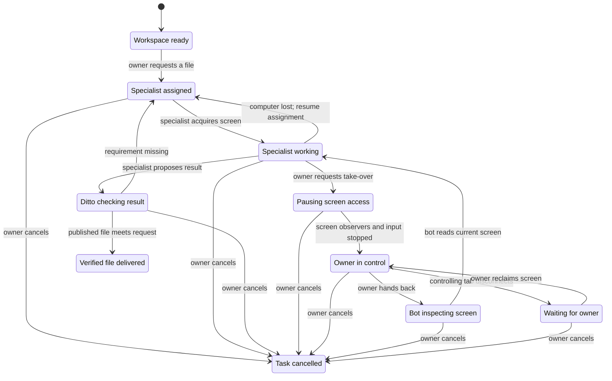

# Workspace architecture

## The personal workspace today

The signed-in home at `/` opens the owner's workspace and shows Ditto, its permanent Chief of Staff, and the shared computer's status. Linked sign-in methods and other devices reach the same workspace through the Better Auth user ID. Opening the page leaves a stopped computer asleep. With a usable model connection, the owner can send Ditto single messages; conversation history and specialist creation come later. [Workspace spec #17](https://github.com/metaloozee/ditto/issues/17)

- **First open.** D1 records a generated workspace ID under a unique account ID. The Workspace Durable Object uses that mapping to record its owner and create Ditto once. A retry after interruption reuses the mapping. The object owns membership and rebuilds the D1 bot list on open or explicit reconciliation. Listing bots reads D1 without waking the object.
- **Request routing.** The website Worker exports Workspace, Bot, Credentials, and ContainerProxy. Its gateway handles `POST /api/workspaces/open` and checks session and ownership on addressed workspace requests. It also checks the origin on WebSocket upgrades. Under `/api/workspaces/<workspaceId>/`, the Worker lists bots, requests reconciliation, serves files, and reports binding status. It forwards computer and host requests to the owner's Workspace object. [Gateway implementation](../apps/web/src/lib/workspace-gateway.server.ts)
- **Shared computer.** Explicit start passes the workspace ID and its approved exact hosts to the Container. The list starts empty. A running instance keeps the list from startup. If the stored list changes, the private-session check returns `list-changed` until the policies match again. The check also requires a running instance with a verified policy and outbound fence. Explicit stop, five minutes of inactivity, or the configured lifetime deadline (one hour by default) destroys the instance. Workspace membership and approved hosts survive. [Workspace implementation](../apps/web/src/workspace.ts)
- **Model access.** Under `/api/models`, the Worker resolves the account from the session and reaches only that account's Credentials object, so no request names an account. Settings connects an owner's OpenCode API key with a model as one pair. Credentials checks the key with OpenCode, stores it encrypted under the stage's `CREDENTIALS_ENCRYPTION_KEY` and bound to the account and provider, and answers only with the connection's state and the default pair. The first pair chosen becomes the default. Connecting never touches sign-in methods. [Model access gateway](../apps/web/src/lib/model-access-gateway.server.ts) · [Credentials implementation](../apps/web/src/credentials.ts)
- **Bot turns.** `POST /api/workspaces/<workspaceId>/bots/<botId>/turns` passes the workspace gateway's ownership check, and then the Workspace object's membership must name the bot. The Bot object asks the account's Credentials object for a grant: the default pair and the one credential that call needs. With no usable connection, the turn is refused before any upstream call. Pi 1.6.0 then streams the reply over SSE, and the Bot records the turn's pair, message, reply and outcome. It never stores the credential. `POST …/stop` aborts the upstream request. [Bot implementation](../apps/web/src/bot.ts) · [Bot routes](../apps/web/src/lib/bot-gateway.server.ts)
- **Provider failures.** A turn whose upstream answers 5xx or not at all stops as interrupted, and its connection becomes Unavailable. Credentials probes it with backoff, from 10 seconds doubling to 10 minutes, and Check again probes once. A 401 or 403 makes the connection Reconnect needed. Its key is never sent again, and new grants on it are refused until the owner connects a new key. When the connection is usable again, through a probe or a reconnect, Credentials asks each waiting Bot to resume. The Bot reruns the interrupted turn on the pair it started with, never on another connection. The browser rereads the turn at `GET …/turns/<turnId>` while it waits. [Credentials implementation](../apps/web/src/credentials.ts)
- **Files and bindings.** The Worker serves existing private R2 objects through the owner-checked route below. Bot and Credentials answer binding probes. Conversations, screen leases, cookie restore, and file publication belong to the later specs.

The disposable deployment recorded on November 25, 2026 verified all six bindings, different destination policies for two workspaces, and owner-only access to a seeded R2 file. Local tests exercise isolation failures. The deployed run supplies the evidence for the outbound fence. [Deployment results](https://github.com/metaloozee/ditto/issues/47) · [Reproduction procedure](feasibility/two-workspace-fence.md)

## Target architecture for delegated work

An owner asks Ditto, the workspace’s Chief of Staff, for a file. A specialist can use the shared computer to produce it. The owner can take over a screen for a private login, hand it back, and later open the verified file even after the computer stops. Specs #18–#23 describe the remaining work on top of the personal workspace. The [feasibility study](feasibility/decision-record.md) records which model and computer capabilities have run on Cloudflare.

| Module                                                         | Interface and durable responsibility                                                                                                                                                                                                                                                                                                |
| -------------------------------------------------------------- | ----------------------------------------------------------------------------------------------------------------------------------------------------------------------------------------------------------------------------------------------------------------------------------------------------------------------------------- |
| Authenticated Worker                                           | Resolve the Ditto account from its session and check ownership before forwarding a request, opening a WebSocket, or serving a file. The server derives resource identities. D1 holds account and workspace lookups and a rebuildable bot-list projection.                                                                           |
| Workspace Durable Object, one per workspace                    | Provision the permanent Chief of Staff once. Own membership, shared profile, tasks, timeline, approvals, and outbox. Record each task transition with its outgoing delivery and use stable operation IDs on retry. The same object owns the Container, screen leases, and encrypted workspace login cookies.                        |
| Bot Durable Object, one per bot                                | Own the bot’s conversation and private memory. Run Pi on Workers Paid. Pin each turn to its selected model and connection. A bot can converse while the computer sleeps. The specialist proposes a result, the Chief of Staff checks it, and the Workspace records completion.                                                      |
| Credentials Durable Object, one per account                    | Store model connections and serialize refresh across bots. An owner can supply an OpenCode key or an eligible ChatGPT plan. The operator can also offer Workers AI. Route included-model requests through Credentials for account attribution. A settings change alone cannot move interrupted work to a different paid connection. |
| Shared computer, one Cloudflare Container per active workspace | Start on demand. Give each active bot a leased screen and Chromium profile on the shared disk. Route screen traffic through the Workspace object. Its filter enforces the site policy the owner confirmed. Check the filter before exposing private logins.                                                                         |
| R2                                                             | Keep published deliverables, screenshots, and home backups outside the disposable instance disk. A deliverable becomes available after a successful upload and remains accessible to its owner after shutdown or specialist deletion.                                                                                               |

Workspace provisioning, model access, and bot turns have separate lifetimes. Reopening a workspace from another device resolves the same Chief of Staff. It need not start the computer or a model turn. Hosted ChatGPT plan onboarding still requires OpenAI approval. [Workspace spec](https://github.com/metaloozee/ditto/issues/17) · [Model access spec](https://github.com/metaloozee/ditto/issues/18) · [Bot spec](https://github.com/metaloozee/ditto/issues/19)

The planned site request pauses the task when the filter reports a blocked navigation. The owner can confirm one host, a site set, a reviewed list, or all sites. Allowing all sites keeps saved logins available and lets a page act through those logins. Live policy updates, blocked-host reporting, verified site sets, and the conversation card remain open. [ADR-0014](adr/0014-ask-the-owner-before-the-shared-computer-reaches-a-site.md) · [Live updates](https://github.com/metaloozee/ditto/issues/48) · [Blocked hosts](https://github.com/metaloozee/ditto/issues/49) · [Site sets](https://github.com/metaloozee/ditto/issues/50) · [Conversation card](https://github.com/metaloozee/ditto/issues/51)

## Where does each file live in R2?

One private bucket, bound to the app Worker as `FILES`, holds every workspace's files. It has no `r2.dev` URL, custom domain, or CORS rule. Every key starts with the workspace ID, so the key and the D1 ownership check alone decide who may read an object. Build keys with `fileKey(workspaceId, kind, name)` in `apps/web/src/lib/workspace-files.ts`. The scheme is stable: changing it strands every object already written.

| Kind           | Key                                | Writer         |
| -------------- | ---------------------------------- | -------------- |
| Published file | `<workspaceId>/published/<name>`   | Delegation #21 |
| Screenshot     | `<workspaceId>/screenshots/<name>` | Computer #20   |
| Home backup    | `<workspaceId>/home/<name>`        | Computer #20   |

`<name>` is one or more `/`-separated segments. The writer chooses its layout, such as `<taskId>/<file>` or `<botId>/<sequence>.png`, and never takes it unchecked from a bot or client. `fileKey` refuses an empty, `.` or `..` segment, a backslash, and a control character. The workspace ID always comes from the server, never from the request.

The owner reads a file at `GET /api/workspaces/<workspaceId>/files/<kind>/<name>`, with each segment percent-encoded. The Worker admits the request through the workspace gateway and derives the key from the admitted workspace ID. A segment that decodes to a separator is refused. Another account's file, an unknown workspace, an unsafe path, and a missing object all answer the same 404. A missing or expired session answers 401. The response carries the stored content type and `Content-Security-Policy: sandbox`, so a published page never runs as the app.

## Planned delegation from assignment to verification

Each box describes what the owner or specialist is waiting for. A lost computer returns the **same assignment** to the specialist. If an external action may already have happened, the specialist checks independent evidence and asks the owner before repeating an action whose outcome is unknown. A missing requirement goes back to the same specialist. Cancellation stops unfinished work throughout the task tree and preserves files already published. [Delegation spec](https://github.com/metaloozee/ditto/issues/21)



**What changes hands during take-over?** The Workspace object invalidates the old screen lease and pauses every bot process that could read or operate that screen, including shell processes started by another bot. Once the screen is private, the owner can enter credentials. A dropped tab loses input rights. The workspace remembers that it is waiting, even across a restart. Only explicit hand-back lets the bot inspect the screen and choose a fresh action. Watching a live view leaves control with its current holder. [Computer spec](https://github.com/metaloozee/ditto/issues/20)

**What does the Desk authorize?** The Desk and conversation display the same durable request. Approval authorizes one execution of the exact action the owner reviewed. A change to the action requires fresh approval. Taking over a screen, approving a send, and handing the screen back are three separate decisions. [Desk spec](https://github.com/metaloozee/ditto/issues/22)

**What survives the computer?** The Workspace retains the task, lease state, and encrypted login cookies. File recovery depends on the last usable checkpoint. A site can still require a new sign-in after cookie restore. After specialist deletion, a restore must respect the deletion even if that leaves the computer stopped. The supported concurrent screen count still requires an active-task benchmark. [Retention and concurrency spec](https://github.com/metaloozee/ditto/issues/23)

## What the chart checks

TLC explored 18 distinct states and 41 steps for one specialist, one screen, and one requested file. In the model, a screen in take-over, reserved after disconnect, or awaiting inspection keeps the task waiting. A working specialist holds bot control. A completed task has a published file and a successful check. TLC found no invariant violation or deadlock. A finished task may remain finished indefinitely.

The chart folds uploads and terminal self-loops into their existing boxes. It models successful verification as a single decision and screen isolation as a prerequisite to granting control. Actual process isolation, reviewer accuracy, durable writes, provider failures, multi-bot races, and eventual completion require separate tests. An owner can leave a task waiting indefinitely.

<details>
<summary>Reproduce the model check</summary>

Save the three blocks below under the indicated names in a scratch directory. From there, run the [statechart skill](https://github.com/cursor/plugins/tree/005d8f6/pstack/skills/statechart) with a fresh output directory. The runner writes Mermaid to `chart.mmd` and the check results to `report.md`.

```sh
"$STATECHART_SKILL/scripts/statechart" Delegation.tla --config Delegation.cfg --view view.mjs --out checked-again
```

`Delegation.tla`

```tla
---- MODULE Delegation ----
VARIABLES phase, screen, published, verified
vars == <<phase, screen, published, verified>>
Init == /\ phase = "Ready" /\ screen = "off"
        /\ published = FALSE /\ verified = FALSE
Assign == /\ phase = "Ready" /\ phase' = "Assigned"
          /\ UNCHANGED <<screen, published, verified>>
Start == /\ phase = "Assigned" /\ phase' = "Working" /\ screen' = "bot"
         /\ UNCHANGED <<published, verified>>
RequestControl == /\ phase = "Working" /\ phase' = "Waiting"
                  /\ screen' = "draining" /\ UNCHANGED <<published, verified>>
GrantControl == /\ screen = "draining" /\ screen' = "owner"
                /\ UNCHANGED <<phase, published, verified>>
Disconnect == /\ screen = "owner" /\ screen' = "reserved"
              /\ UNCHANGED <<phase, published, verified>>
Reclaim == /\ screen = "reserved" /\ screen' = "owner"
           /\ UNCHANGED <<phase, published, verified>>
HandBack == /\ screen = "owner" /\ screen' = "inspect"
            /\ UNCHANGED <<phase, published, verified>>
Inspect == /\ screen = "inspect" /\ screen' = "bot" /\ phase' = "Working"
           /\ UNCHANGED <<published, verified>>
LoseComputer == /\ phase = "Working" /\ phase' = "Assigned" /\ screen' = "off"
                /\ UNCHANGED <<published, verified>>
Publish == /\ phase = "Working" /\ published' = TRUE
           /\ UNCHANGED <<phase, screen, verified>>
Propose == /\ phase = "Working" /\ phase' = "Checking" /\ screen' = "off"
           /\ UNCHANGED <<published, verified>>
ReturnWork == /\ phase = "Checking" /\ phase' = "Assigned"
              /\ UNCHANGED <<screen, published, verified>>
Accept == /\ phase = "Checking" /\ published /\ verified' = TRUE
          /\ phase' = "Complete" /\ UNCHANGED <<screen, published>>
Cancel == /\ phase \in {"Assigned","Working","Waiting","Checking"}
          /\ phase' = "Cancelled" /\ screen' = "off"
          /\ UNCHANGED <<published, verified>>
Done == /\ phase \in {"Complete","Cancelled"} /\ UNCHANGED vars
Next == Assign \/ Start \/ RequestControl \/ GrantControl \/ Disconnect
        \/ Reclaim \/ HandBack \/ Inspect \/ LoseComputer \/ Publish
        \/ Propose \/ ReturnWork \/ Accept \/ Cancel \/ Done
ExclusiveInput == screen \in {"owner","reserved","draining","inspect"} => phase = "Waiting"
BotNeedsScreen == phase = "Working" => screen = "bot"
VerifiedFile == phase = "Complete" => published /\ verified
====
```

`Delegation.cfg`

```text
INIT Init
NEXT Next
INVARIANT ExclusiveInput BotNeedsScreen VerifiedFile
```

`view.mjs`

```js
const phases = {
  Ready: "Workspace ready",
  Assigned: "Specialist assigned",
  Working: "Specialist working",
  Checking: "Ditto checking result",
  Complete: "Verified file delivered",
  Cancelled: "Task cancelled",
};
const screens = {
  draining: "Pausing screen access",
  owner: "Owner in control",
  reserved: "Waiting for owner",
  inspect: "Bot inspecting screen",
};
export const state = (v) => phases[v.phase] ?? screens[v.screen];
export const step = (a) =>
  ({
    Assign: "owner requests a file",
    Start: "specialist acquires screen",
    RequestControl: "owner requests take-over",
    GrantControl: "screen observers and input stopped",
    Disconnect: "controlling tab disconnects",
    Reclaim: "owner reclaims screen",
    HandBack: "owner hands back",
    Inspect: "bot reads current screen",
    LoseComputer: "computer lost; resume assignment",
    Propose: "specialist proposes result",
    ReturnWork: "requirement missing",
    Accept: "published file meets request",
    Cancel: "owner cancels",
    Publish: "file uploaded",
    Done: "finished",
  })[a];
```

</details>
